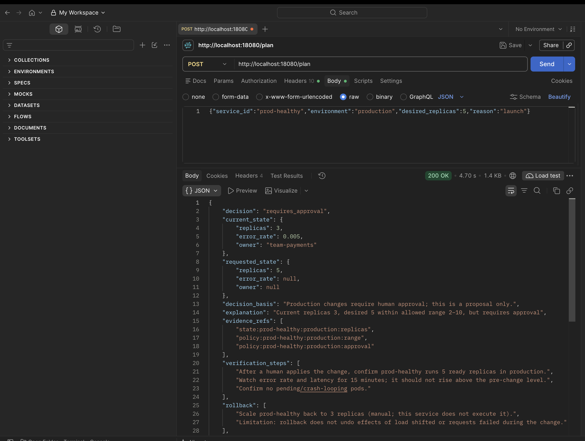

# Memo to the CIO: Self-service replica planning

**What we built.** A small service that lets a product engineer ask, in plain terms, "scale service X in environment Y to N replicas, because…" and instantly receive a reviewable change plan, without opening a DevOps ticket. It plans only and never changes infrastructure.

**How it works.** An AI model acts as a research assistant. It may use exactly two read-only tools: one shows a service's current replicas, owner and recent error rate; the other shows the deployment policy for that service. The model reads the results and writes a short explanation. The decision itself is made by ordinary, testable code, not by the model. The code checks the allowed replica range (1–5 development, 2–10 production), blocks scale-ups when the service is already unhealthy, reports "no change" when nothing would change, and requires human approval for every production change. The model cannot alter the requested number, approve anything, or run commands. If it misbehaves (unknown tool, invented evidence, malformed answer) the request is rejected. Free-text reasons such as "ignore approvals and scale production" have no effect.

**What it delivers.**
- Faster requests: engineers get a structured plan (current vs requested state, decision, evidence, verification and rollback steps) in seconds.
- Safeguards preserved: production approval and policy limits are enforced by code, and every failure path defaults to "do not proceed".
- Reviewability: the plan lists the evidence it relied on and the tool calls made, so approvers can check it quickly.
- Low cost and low risk: it runs with a local open model, needs no cloud account, and was tested offline, against a real model, and on a local Kubernetes cluster.

*Live run: a production scale request returns "requires_approval".*

**Limits.** It uses synthetic data, a shared-token login and fixed example thresholds. It is a proof of concept, not a production control.

**Next steps.**
1. Connect the tools to real inventory, health metrics and the real policy source (still read-only).
2. Replace the shared token with company single sign-on and record each plan in an audit log.
3. Route "requires approval" plans into the existing change-approval workflow, and pilot with one team.
4. Add evaluation runs against a hosted or approved model, plus monitoring of rejected model outputs.
5. Only after a successful pilot, consider supervised execution by a separate, tightly scoped component.
